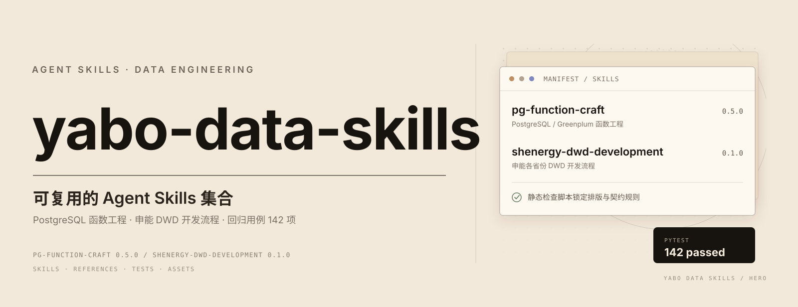

# yabo-data-skills



可复用的 Agent Skills 集合，通过通用 skills CLI 分发，不绑定特定的 Agent 或 IDE。

当前收录两个技能：

| Skill | 版本 | 适用任务 | 依赖 |
|---|---:|---|---|
| `pg-function-craft` | 0.4.4 | 生成、改写、审查 PostgreSQL / Greenplum 函数、存储过程和触发器函数 | Python 3.10+，只做离线静态检查 |
| `shenergy-dwd-development` | 0.0.6 | 按省份、业态开展申能 DWD 口径、探源、DDL、计算、验收和交接 | 同时安装 `pg-function-craft`；按任务需要访问建表工匠、源库和目标库 |

如果只处理 SQL 函数，安装 `pg-function-craft` 即可。要做申能 DWD 开发，两个技能都要安装；`shenergy-dwd-development` 负责业务流程和证据，`pg-function-craft` 负责函数工程与静态检查。

## 5 分钟接入

1. 确认本机可以使用 `npx` 和 Python 3.10+。
2. 配置私有仓库的 GitHub 访问凭据。
3. 安装需要的技能。
4. 运行离线自检，确认技能目录完整。
5. 按任务准备业务资料和授权，再让 Agent 开始工作。

把下面这段提示词直接发给 Agent。它会先完成安装和开工准备度盘点，不会直接开始业务开发：

```text
你正在接入 yabo-data-skills。请先完成环境准备和开工准备度盘点，不要直接生成正式 SQL 或业务产物。

1. 检查 Node.js、npx、Python 3.10+、Git 和 GitHub 凭据是否可用。只报告缺失项，不要伪造版本或登录状态。
2. 安装两个技能：
   npx skills add gyb-cpu/yabo-data-skills --skill pg-function-craft
   npx skills add gyb-cpu/yabo-data-skills --skill shenergy-dwd-development
   如果当前 CLI 参数不支持，先运行 npx skills add --help，再按其说明执行。私有仓库返回 404 时，停止并告诉我需要先配置 GitHub 凭据。
3. 找到两个技能实际安装的目录，确认目录名分别与 SKILL.md 的 name 一致，并读取两个 SKILL.md 的版本和触发条件。
4. 在 pg-function-craft 技能目录执行：
   python scripts/verify_offline.py --json
   只有 ok 为 true 且 issues 为空才算通过；失败时原样报告问题，不要改文件绕过检查。
5. 如果本次用于申能 DWD 任务，读取 shenergy-dwd-development 的 SKILL.md 和“使用前文件清单”，先判断是首次开发还是存量维护。首次开发只确认省份、业态、业务项目绝对路径、任务日期、当天 BI 看快照路径和只读探查授权；目标表、目标 DDL、字段映射和计算脚本属于待产出，不要要求我预先提供。存量维护再检查现有目标表、DDL、函数和映射。
6. 检查业务项目根目录的 .env.shenergy：
   - 文件不存在时，提醒我从技能目录复制 .env.example，但不要自行填写；
   - 只报告缺失或未确认的变量名，例如 TABLEFORGE_URL、SOURCE_MYSQL_HOST、TARGET_PG_HOST；
   - 禁止读取后回显配置值、密码、token 或完整连接信息；
   - 配置存在不等于已获得数据库写权限或平台修改权限。
7. 检查参考资料并列出明确状态：
   - 任务当天 BI 看快照 .xlsx 的绝对路径、sheet 和表头；
   - 已有项目规范、源表登记、现有 DDL、函数和字段映射；首次开发没有这些时标为“无存量资料，后续产出”，不要标成阻塞；
   - 只有文件名、目录名或“在本地”时，视为“地址未提供”，不要自行搜索猜测。
8. 不要在本轮生成正式 SQL 或宣称产物已完成。按下表汇报：
   | 事项 | 类型 | 状态 | 证据或待产出 | 影响 |
   类型只能使用“输入 / 产出”。输入状态使用“通过 / 未提供 / 未验证”，产出状态使用“待产出 / 已生成 / 阻塞”。目标表清单、字段映射、DDL、计算脚本和验收记录都属于产出；首次开发不得因这些尚未产出而阻塞准备度盘点。当天快照和只读数据探查能力阻塞事实取证；写库授权只阻塞部署、回算和正式写入。
9. 最后给我一段可直接复制的“开工提示词”，其中只填写我已经确认的信息；仍有阻塞时，明确列出哪些产物暂不能生成。

执行约定：
1. 除任务已经完成，或确实缺少用户才能提供的文件、配置或授权外，不要提前结束。
2. 遇到阻塞时，先完成不依赖该阻塞的盘点、核对和可生成产物，再说明阻塞，不要丢掉已完成进度。
3. 每次暂停必须输出整体状态（NEED_USER_INPUT / BLOCKED / READY）、已确认内容、具体缺少的变量名或文件绝对路径、受影响阶段、补齐后从哪一步继续。
4. 配置文件只检查变量是否存在，不输出值、密码、token 或完整连接信息。
5. 无法访问 GitHub 私有仓库时，先报告认证失败，不要改用来源不明的副本。
6. 当前 Agent 不支持 skills CLI 时，提示我改用手动复制技能目录的方式，不要假装安装成功。
7. 需要数据库、平台或文件访问授权时，一次性说明所需权限；获得授权后从当前阶段继续，不要重新开始整个任务。
8. 不要因为非关键文件缺失就停止全部工作。首次开发的目标表、DDL、字段映射和计算脚本是产出；缺少当天快照或只读探查能力时阻塞事实取证，缺少写库授权时只阻塞部署、回算和正式写入，不阻塞本地候选产物。
```

安装完成后，日常使用时直接用自然语言描述任务即可。Agent 应根据 `SKILL.md` 的触发条件选择技能；如果它没有自动触发，可以在任务开头明确写“使用 `pg-function-craft`”或“使用 `shenergy-dwd-development`”。

### Agent 暂停与恢复

提示词不能保证所有 Agent 都无中断运行。第一轮在“准备度盘点”后结束等待用户补齐，属于设计内暂停，不是安装失败。即使环境和文件都已准备好，仍可能因安装权限、网络、私有仓库认证、文件访问范围、数据库授权或任务超时而暂停。

| 类型 | 典型原因 | 处理方式 |
|---|---|---|
| 设计内暂停 | `.env.shenergy` 未配置、快照未提供、只读探查未授权、存量维护所需资料未给、写库动作未授权 | 输出阻塞清单，等待用户补齐 |
| 技术性中断 | Agent 不支持 skills CLI、无 shell、网络受限、GitHub 登录失效、工作区外文件无法读取 | 切换手动复制安装，或让用户提供可访问目录 |
| 权限性中断 | 数据库连接、写库、回算、平台变更需要确认 | 这是正常保护，不要在提示词中取消 |
| 流程性中断 | Agent 把“生成开工提示词”当成任务结束，没有继续执行 | 用执行约定明确暂停条件、恢复点和继续位置 |
| 长任务中断 | 探源、全量扫描或多表输出超过 Agent 时限 | 按阶段拆分，保留状态和已完成产物 |

正常暂停应带有 `NEED_USER_INPUT`、`BLOCKED` 或 `READY` 状态，并列出用户可以实际补齐的变量名、文件绝对路径或授权。只写“资料缺失”“配置未完成”而不说缺什么的回复，不算完成准备度盘点。

首次开发时，目标表清单、字段映射、目标 DDL、计算脚本和验收报告是技能的产出，不是用户的开工前置条件。把它们列为“未提供”并暂停任务，属于错误判断。

## 安装

### 前置条件

| 项目 | 要求 | 用途 |
|---|---|---|
| Node.js / npm | 建议使用当前 LTS，能够运行 `npx` | 安装和更新 skills |
| Python | 3.10+；仓库测试在 3.12 下验证 | 运行离线检查器和回归测试 |
| Git / GitHub 凭据 | 能访问私有仓库 `gyb-cpu/yabo-data-skills` | skills CLI 拉取仓库 |
| Agent | 支持读取 `SKILL.md` 形式的技能目录，或支持 skills CLI | 发现和加载技能 |
| 业务环境 | 申能任务需要按范围获得建表工匠、源 MySQL、目标 PostgreSQL 的访问能力 | 探源、编译、部署和验收；不以拥有凭据代替写权限授权 |

### 安装指定技能

在任意目录执行：

```bash
npx skills add gyb-cpu/yabo-data-skills --skill pg-function-craft
npx skills add gyb-cpu/yabo-data-skills --skill shenergy-dwd-development
```

两个技能分别安装、独立更新。安装位置由 skills CLI 或目标 Agent 决定，可能是用户级技能目录，也可能是项目内目录，以 CLI 的实际输出和 Agent 文档为准。

本仓库是私有仓库，匿名拉取会返回 404。先在本机完成 GitHub 登录，例如：

```bash
gh auth login
```

也可以使用现有的 Git 凭据管理器。不要把 token 写进命令、仓库文件或交付物。

### 自动发现安装

如果所用 CLI 支持扫描仓库内的 `skills/` 目录，可以省略 `--skill`：

```bash
npx skills add gyb-cpu/yabo-data-skills
```

随后按提示选择技能。做申能 DWD 开发时选择两个技能。不同 CLI 版本的参数可能不同，必要时先查看：

```bash
npx skills add --help
```

### 不使用 CLI 时

把需要的技能目录完整复制到目标 Agent 的技能根目录：

- `skills/pg-function-craft/`
- `skills/shenergy-dwd-development/`

目标目录名必须与 `SKILL.md` frontmatter 中的 `name` 完全一致，否则技能发现和后续更新可能错位。`pg-function-craft` 必须保留 `SKILL.md`、`README.md`、`CHANGELOG.md`、`references/`、`scripts/`、`tests/` 和 `assets/`。申能技能必须保留 `SKILL.md`、`CHANGELOG.md`、`references/` 和 `.env.example`；实际 `.env.shenergy` 只放在业务项目本地，不随技能分发。

### 安装后验证

在 `pg-function-craft` 技能根目录执行：

```bash
python scripts/verify_offline.py --json
```

预期至少满足：

```json
{
  "ok": true,
  "issues": [],
  "warnings": [],
  "database_connected": false
}
```

该脚本只使用 Python 标准库，不连接数据库、不访问网络、不执行 SQL。它检查文件完整性、技能名称、文档引用、编码、换行和禁止夹带内容，不代表 SQL 已在数据库中编译通过。

申能技能没有独立的自检脚本。至少确认 Agent 能加载 `shenergy-dwd-development/SKILL.md`，并能读取 `references/` 下的四份说明。需要访问平台或数据库时，再检查 `.env.shenergy` 和对应授权。

### 更新已安装技能

skills CLI 不会自动监听 GitHub 仓库更新。通过 CLI 安装的用户需要显式执行更新。

安装时使用了 `-g`：

```bash
npx skills update -g
```

安装时没有使用 `-g`：

```bash
npx skills update
```

如果当前 CLI 不支持 `update`，或者更新后版本没有变化，重新执行安装命令覆盖旧版本：

```bash
npx skills add gyb-cpu/yabo-data-skills --skill pg-function-craft
npx skills add gyb-cpu/yabo-data-skills --skill shenergy-dwd-development
```

更新后重新检查两个 `SKILL.md` 的 `version`，并运行：

```bash
cd <pg-function-craft 技能目录>
python scripts/verify_offline.py --json
```

手动复制的技能不会自动更新。维护者可以使用目录联接指向 Git 仓库并通过 `git pull` 更新；普通使用者需要重新复制技能目录。`.env.shenergy` 位于业务项目根目录，更新技能不会修改本地配置。

#### Agent 开工前版本检查

每次开始依赖这些技能的任务前，可以发送下面的提示词。该检查只报告并请求确认，不静默更新：

```text
开始任务前，请检查 yabo-data-skills 两个技能是否需要更新。

1. 读取已安装的 pg-function-craft 和 shenergy-dwd-development 的 SKILL.md，记录当前版本和实际安装路径。
2. 检查当前 skills CLI 是否支持 update。不要静默执行 git pull、覆盖技能目录或重新安装。
3. 如果支持 update，先告诉我当前版本、将要执行的命令和可能影响，等待我确认后再更新。
4. 如果不支持 update，或无法判断远端是否有更新，告诉我当前版本，并给出按原安装作用域重新安装的命令，等待我确认。
5. 更新成功后重新读取两个版本，并运行 pg-function-craft 的 verify_offline.py --json。
6. 汇报更新前后版本、实际路径和自检结果。更新失败时继续使用本地版本，但必须明确标注“未确认最新”。
```

## 环境配置

### Agent 运行环境

`pg-function-craft` 不需要数据库驱动，也不需要数据库连接。Agent 只要能读取技能文件并运行 Python 即可。

`shenergy-dwd-development` 会在获得授权后读取业务证据、访问平台或数据库。本仓库不内置数据库驱动、平台 SDK 或自动化执行器；Agent 应复用其运行环境中已有的连接器、CLI 或安全凭据机制，不能假设这些能力已经存在。

### 申能配置：`.env.shenergy`

将申能技能目录下的 `.env.example` 复制到业务项目根目录，命名为 `.env.shenergy`。PowerShell 示例：

```powershell
Copy-Item "<技能安装目录>\shenergy-dwd-development\.env.example" ".env.shenergy"
Add-Content ".gitignore" ".env.shenergy"
```

Linux / macOS 示例：

```bash
cp "<技能安装目录>/shenergy-dwd-development/.env.example" .env.shenergy
printf '\n.env.shenergy\n' >> .gitignore
```

配置只在本机填写，不得提交、打包、发送或写入交付物。变量含义如下：

| 变量组 | 变量 | 说明 |
|---|---|---|
| 建表工匠 | `TABLEFORGE_URL` | 平台地址 |
| 建表工匠 | `TABLEFORGE_USERNAME`、`TABLEFORGE_PASSWORD` | 账号密码认证方式；是否必填以平台为准 |
| 建表工匠 | `TABLEFORGE_TOKEN` | token 认证方式；与账号密码按实际认证方式选择 |
| 源 MySQL | `SOURCE_MYSQL_HOST`、`SOURCE_MYSQL_PORT`、`SOURCE_MYSQL_DATABASE` | 源库地址、端口和数据库 |
| 源 MySQL | `SOURCE_MYSQL_USER`、`SOURCE_MYSQL_PASSWORD` | 只读账号；不要把只读账号视为写库授权 |
| 源 MySQL | `SOURCE_MYSQL_SSL_MODE` | 按驱动和服务器要求填写，不能把空值理解为已启用 TLS |
| 目标 PostgreSQL | `TARGET_PG_HOST`、`TARGET_PG_PORT`、`TARGET_PG_DATABASE` | 目标库地址、端口和数据库 |
| 目标 PostgreSQL | `TARGET_PG_USER`、`TARGET_PG_PASSWORD` | 探查阶段使用只读账号 |
| 目标 PostgreSQL | `TARGET_PG_SSLMODE` | 按实际连接要求填写 |

多省份、多业态或多环境不能共用一组不明范围的连接。无法唯一确定目标时，应先明确本次任务使用的环境，不要让 Agent 猜配置。

## 使用前需要准备什么

### 通用准备

- 明确任务目标、业务项目路径和期望交付物。
- 明确本次操作边界：离线、只读、事务内试跑、允许写库、允许回算或允许平台变更。
- 指定要使用的技能；申能 DWD 任务默认需要两个技能。
- 准备项目已有的规范、命名约定、历史决策和验收标准。
- 去掉凭据、个人信息和无关敏感数据后再交给 Agent 阅读。

### `pg-function-craft` 文件清单

| 使用模式 | 必须提供 | 缺失后的影响 |
|---|---|---|
| `generate` | 函数用途、输入输出、业务规则、目标 schema / 表、字段类型、调用方式 | 可以生成带假设的候选 SQL，但无法保证可部署 |
| `generate` / `rewrite` | PostgreSQL 或 Greenplum 版本 | 无法确认语法、函数形态和版本兼容性 |
| `generate` / `rewrite` | 目标表 DDL、主键、约束、索引 | 可能生成错误的列、类型、幂等或性能方案 |
| `rewrite` / `review` | 完整现有函数定义和调用上下文 | 无法可靠做等价改写或定位行号问题 |
| `review` | 数据量级、日期范围、执行频率、并发或上游调度信息 | 只能给静态风险，不能给实测性能结论 |
| 任意模式 | 不能改变的签名、异常处理、返回码和部署约束 | 可能误改调用方依赖的外部契约 |

推荐同时提供脱敏后的示例数据或字段说明，但不要把生产数据、连接串或凭据放进 SQL 文件和提示词。

### `shenergy-dwd-development` 文件清单

| 场景或阶段 | 用户需要提供 | 说明 |
|---|---|---|
| 首次开发 | 省份、业态、业务项目目录、任务日期、当天 BI 看快照路径、源端/目标端/平台只读探查授权 | 目标表清单、字段映射、DDL、计算脚本和验收报告是本次产出，不是前置输入 |
| 存量维护 | 首次开发的输入，加上现有目标表、DDL、函数、字段映射和变更范围 | 目标表已存在时，业务列名以现库既有列为准，不按平台条目或快照原文改名 |
| 口径 | 当天 BI 看快照 `.xlsx`，保留文件名、日期、sheet 和表头 | 输入项；没有当天快照时，正式口径和事实取证阻塞，历史资料只能用于明确标注的演练 |
| 探源 | `.env.shenergy` 和实际只读访问能力 | 源表登记、同步方式和覆盖信息可由技能探查后产出；不要要求用户预先完成整份源表登记 |
| 命名与字段 | 项目命名规范、平台只读访问和必要业务确认人 | 字段候选、查重结果和平台补录项由技能产出；口径冲突未确认时标 `open_questions` |
| DDL | 首次开发只需项目类型规范；存量维护再提供现有 DDL、约束、索引和主键 | 目标 DDL 由技能产出；已有对象必须先比对真实结构 |
| 计算脚本 | 首次开发只需业务目标；改写时再提供现有函数签名、异常、返回码和调用契约 | 函数 SQL 和检查器结果由技能产出；写函数前必须调用 `pg-function-craft` |
| 验收 | 验收口径、只读对账能力、允许差异和业务确认人 | 验收 SQL 和报告由技能产出；静态检查不能代替数据库编译和实际验收 |
| 权限 | 本地产物写入授权、数据库只读授权；部署、写库、回算权限按后续动作单独确认 | 只读授权足以生成候选产物；不能因缺少写库授权就停止本地设计 |

`shenergy-dwd-development` 会在用户指定的省份/业态根目录下按需要生成 `参考资料/`、`DDL/`、`计算脚本/` 和 `复核验证/`。不要为尚未确认的阶段预建空 SQL 冒充完成。

## 使用

安装后直接用自然语言描述任务。建议在任务开头写明技能名、项目路径、授权范围和期望产物，减少 Agent 自行猜测。

### PostgreSQL 函数

```text
使用 pg-function-craft 审查这个 PostgreSQL 函数。
目标版本：PostgreSQL 14。
关注：动态 SQL、异常处理、增量删除范围、索引适配和固定风格。
只能只读分析，不连接数据库，不执行 SQL。
函数定义如下：……
```

常用模式：

| 需求 | 模式 | 示例 |
|---|---|---|
| 新写函数、过程或触发器函数 | `generate` | “写一个按日期范围落表的 PG 函数” |
| 让已有函数符合固定风格 | `rewrite` | “按 pg-function-craft 重写这个函数，保持行为不变” |
| 检查安全、正确性、性能和风格 | `review` | “审查这个函数的性能和 SQL 写法” |

### 申能 DWD 开发

先判断本次是首次开发还是存量维护。首次开发只需要省份、业态、业务项目路径、任务日期、当天快照和只读探查授权；目标表清单、字段映射、DDL、计算脚本和验收记录由技能产出，不能作为用户必须提前提供的材料。

发送接入提示词并确认准备清单后，再使用下面的对应模板。

#### 首次开发

```text
准备清单已补齐并确认。

请使用新安装的 shenergy-dwd-development 技能，为 <省份> <业态> 执行首次 DWD 开发。
涉及函数生成、改写或审查时，同时使用 pg-function-craft，并留存其检查器结果。

开发模式：首次开发
业务项目绝对路径：<绝对路径>
输出根目录：<省份业态目录>
省份和业态：<省份> / <业态>（如：安徽 / 售电）
任务日期：<日期>
开发范围：<按当天 BI 看和源端证据识别，或指定业务范围>
当天 BI 看快照绝对路径：<绝对路径>
已有项目规范或参考资料：<可选绝对路径；没有写“无”>

.env.shenergy 已在本机准备。请先检查实际可读取性和必要变量是否齐全，只报告缺失变量名，不要输出配置值。

本次授权范围：
  - 源端、目标端和平台只读探查：是
  - 本地产物写入：是
  - 平台变更：否/待确认
  - 数据库写入：否/待确认
  - 事务内试跑：否/待确认
  - 正式部署：否/待确认
  - 回算：否/待确认

执行要求：
1. 目标表清单、字段映射、目标 DDL、计算脚本、源表登记和验收记录是本次产出。不要要求我预先提供，也不要因这些尚未产出而阻塞准备度盘点。
2. 先读取 shenergy-dwd-development 的流程和产物契约，从当天快照与只读探查中识别目标表、指标、粒度、业务键和来源。
3. 无法确认的字段、口径、平台词条或业务规则写入 open_questions，不得猜测或补造。
4. 写函数前调用 pg-function-craft，并留存 check_sql_output.py --json 的实际输出；检查器通过后仍需完成数据库编译验证。
5. 在本地按产物契约生成：
   参考资料/、DDL/、计算脚本/、复核验证/
6. 每个阶段报告：
   - artifacts：实际文件路径
   - gates：通过、阻塞或未验证及证据
   - open_questions：待确认问题及影响
   - next：下一阶段动作和所需授权

关键快照或只读探查能力缺失时，输出阻塞清单。缺少写库、部署或回算授权只阻塞对应运行阶段，不阻塞本地候选产物。
```

#### 存量维护或改写

```text
准备清单已补齐并确认。

请使用新安装的 shenergy-dwd-development 技能，维护 <省份> <业态> 的存量 DWD。
涉及函数生成、改写或审查时，同时使用 pg-function-craft，并留存其检查器结果。

开发模式：存量维护
业务项目绝对路径：<绝对路径>
省份和业态：<省份> / <业态>
任务日期：<日期>
目标表和变更范围：<目标表与范围>
现有 DDL：<绝对路径>
现有函数：<绝对路径>
字段映射：<绝对路径>
当天 BI 看快照：<绝对路径>

.env.shenergy 已在本机准备。请先检查实际可读取性和必要变量是否齐全，只报告缺失变量名，不要输出配置值。

授权范围：
  - 源端、目标端和平台只读探查：<是/否>
  - 本地产物写入：<是/否>
  - 数据库写入：<是/否/待确认>
  - 事务内试跑：<是/否/待确认>
  - 正式部署：<是/否/待确认>
  - 回算：<是/否/待确认>

开工前复核既有表结构、列名、函数签名和调用契约。目标表已存在时，业务列名以现库既有列为准；改名属于破坏性变更，必须单独列影响并获授权。

每个阶段报告：
- artifacts：实际文件路径
- gates：通过、阻塞或未验证及证据
- open_questions：待确认问题及影响
- next：下一阶段动作和所需授权
```

每次阶段性交付应明确：

- `artifacts`：实际生成或更新的文件路径。
- `gates`：通过、阻塞或未验证，并附证据。
- `open_questions`：仍需业务确认的问题及其影响。
- `next`：下一阶段可以执行的动作和所需授权。

## 常见问题

### 安装时返回 404

先用 `gh auth login` 或 Git 凭据管理器确认能访问私有仓库，再重新执行安装。不要改用公开镜像或来源不明副本。

### Agent 没有触发技能

先检查安装目录名是否与 `SKILL.md` 的 `name` 一致，再重启 Agent 让它重新扫描技能。仍不触发时，在任务中直接写“使用 `pg-function-craft`”或“使用 `shenergy-dwd-development`”。

### `python` 命令不存在

先安装 Python 3.10+。部分 Linux / macOS 环境使用 `python3`，把命令中的 `python` 替换为 `python3` 即可。

### 申能任务提示配置缺失

只报告缺失的变量名、受影响阶段和不含秘密的原因。让使用者在本地补齐 `.env.shenergy`，不要在日志、聊天或交付物中展开配置值。

### 检查器返回 `ok: false`

按 `issues` 中的规则逐项修正源文件。`pg-function-craft` 的检查器不解析完整 SQL 语法；通过后仍需在授权范围内做数据库编译验证。

### 无法连接数据库或平台

先确认对应变量、网络、账号权限和本次任务授权。连接失败时继续完成不依赖连接的盘点或映射工作，把依赖连接的结果标为未验证，不要伪造成功。

## 本地开发：让技能跟随仓库更新

如果在本机维护仓库，又希望 Agent 始终读取最新版本，不要复制副本。用目录联接把本地技能目录指向仓库子目录。以下以 `~/.minimax/skills` 为例：

```powershell
# 1. 现有副本改名留底，不删除
Rename-Item "$env:USERPROFILE\.minimax\skills\pg-function-craft" "pg-function-craft.bak"

# 2. 建立目录联接
cmd /c mklink /J "$env:USERPROFILE\.minimax\skills\pg-function-craft" `
  "<仓库绝对路径>\skills\pg-function-craft"
```

验证：

```powershell
Get-Item "$env:USERPROFILE\.minimax\skills\pg-function-craft" | Select-Object LinkType,Target
```

`LinkType` 应为 `Junction`，`Target` 指向仓库子目录。此后 `git pull` 即完成技能更新。

约束：

- 仓库目录不能移动或改名，否则联接断开。
- 切换分支会直接影响 Agent 读到的技能版本。
- 备份目录应放在技能目录之外，避免被识别成第二个同名技能。
- 其他 Agent 使用同一方法，只需替换其技能根目录。

如果不使用联接，继续用 `npx skills add ... -g` 安装，并用 CLI 支持的更新命令更新。这样会保留一份副本。

## 仓库结构

```text
yabo-data-skills/
  README.md                          本文件：安装、配置和使用说明
  assets/
    yabo-data-skills-hero.svg        README 封面
  tests/                             仓库级回归测试
    README.md                        测试职责说明
    test_*.py                        规则文本、脚本契约和发布形态测试
  skills/
    shenergy-dwd-development/        申能 DWD 开发流程与配置模板
      SKILL.md
      CHANGELOG.md
      .env.example                   不含凭据的连接配置模板
      references/                    流程、产物、函数与连接说明
    pg-function-craft/
      SKILL.md                       技能主规则与触发入口
      README.md                      技能自身说明
      CHANGELOG.md                   版本变更记录
      assets/                        图示资源
      references/                    规则参考文档
      scripts/verify_offline.py      离线完整性检查
      scripts/check_sql_output.py    SQL 输出规则检查
      scripts/verify_output_contract.py  模式输出契约校验
      tests/                         验收场景与检查器回归测试
```

## 开发与验证

### 技能修改与发版约定

修改任一技能目录后，按以下顺序处理：

1. 在对应 `SKILL.md` 的 frontmatter 中递增 `version`。
2. 在对应 `CHANGELOG.md` 顶部增加同版本条目，写明行为变化和影响。
3. 同步 README 技能表中的版本号；涉及申能版本时同步封面资源中的版本标识。
4. 运行仓库回归测试和 `pg-function-craft` 离线自检。

版本号采用语义化规则：

- 文本纠正、措辞澄清、无行为变化：递增 `PATCH`。
- 新增规则、改变默认输出或增加必调流程：递增 `MINOR`。
- 删除或不兼容地改变既有契约：递增 `MAJOR`。

只看文件时间无法判断技能是否最新。`SKILL.md` 的 `version` 和 `CHANGELOG.md` 是更新判断依据，因此技能行为或规则发生变化时必须同步修改两者。

### 本地检查

修改规则或脚本后，在仓库根目录运行：

```bash
python -m unittest discover -s tests -p "test_*.py" -v
```

再到 `pg-function-craft` 技能根目录运行：

```bash
python scripts/verify_offline.py --json
```

两层都通过再提交。测试文件中的 `_red` 是历史命名，当前全部为绿色用例。

## 边界说明

- 仓库可以携带无凭据的配置模板，但不得携带实际连接配置、凭据、开发语料、样例库、风格档案或导出元数据。
- `shenergy-dwd-development` 根据具体任务授权访问平台和数据库；`pg-function-craft` 只处理离线函数工程。
- `pg-function-craft` 默认不连接数据库，不执行 SQL、DDL、DML、`ANALYZE`、`VACUUM` 或 `EXPLAIN`；性能结论只做静态标记。
- 仓库以各技能 `SKILL.md` 的 `version` 和对应 `CHANGELOG.md` 作为版本来源；使用者需通过 CLI 更新、重新安装或目录联接同步，不会自动跟随仓库。
